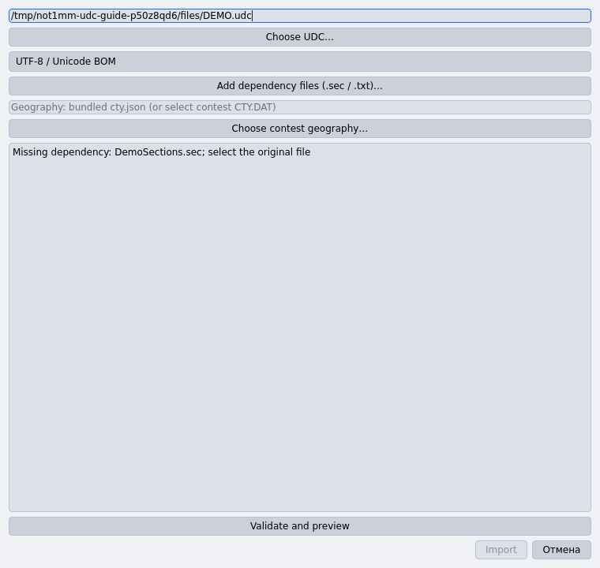
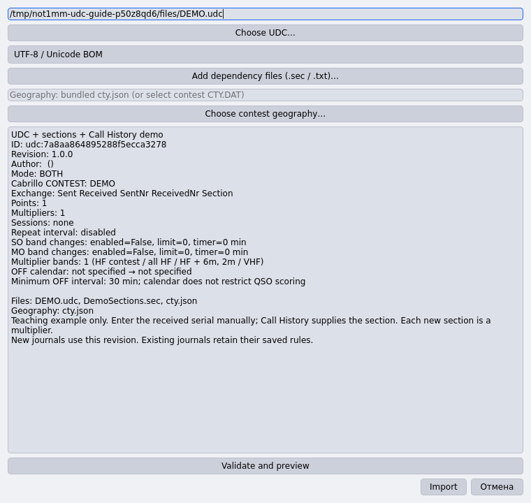
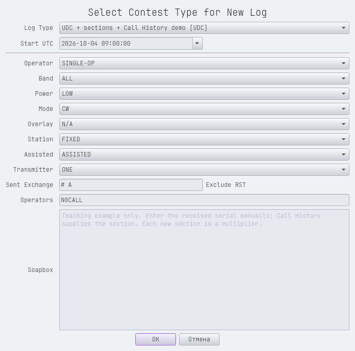
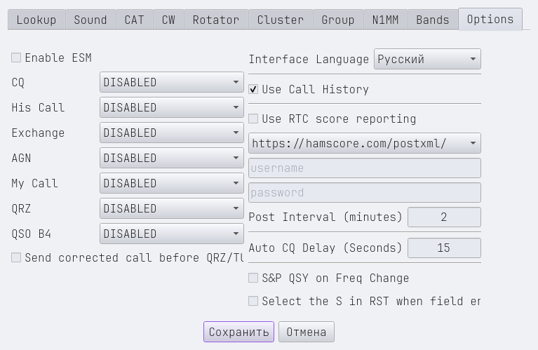
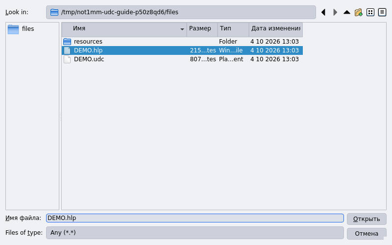
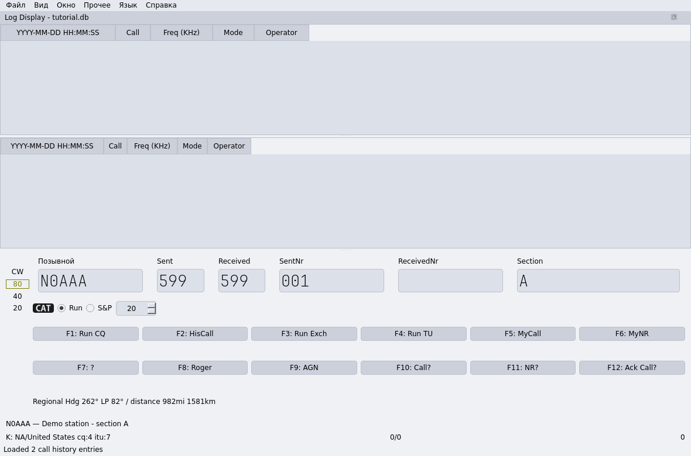

# Подключение UDC, SEC и HLP

[English](udc-setup.md) · [Возможности и ограничения](udc-ru.md)

`.udc` задаёт правила соревнования, `.sec` — список секций или районов,
а `.hlp` в формате Call History — подсказки по позывным. UDC и его справочники
импортируются вместе. HLP загружается отдельно в текущую базу журнала.

## 1. Подготовьте файлы

Для знакомства используйте собственный учебный комплект проекта:

- [DEMO.udc](../examples/udc/tutorial/DEMO.udc) — учебные правила;
- [DemoSections.sec](../examples/udc/tutorial/resources/DemoSections.sec) — секции A и B;
- [DEMO.hlp](../examples/udc/tutorial/DEMO.hlp) — две вымышленные записи Call History.

Сохраните файлы через **Raw / Download raw file** либо используйте их из
клонированного репозитория. Это учебные данные под GPL-3.0-or-later,
а не правила официального соревнования.

В комплекте SEC лежит в подкаталоге `resources`, чтобы показать его явное
подключение. Если нужный SEC находится рядом с UDC, приложение обнаружит
его автоматически. Имя должно совпадать с тем, которое запрашивает определение.
В примере это `DemoSections.sec`, а первая строка — `Type=DemoSections`.

Перед открытием рабочей базы обновлённым приложением сохраните резервную копию.
Для первого знакомства создайте отдельную учебную базу и заполните данные станции.

## 2. Выберите UDC

Откройте **Файл → Импорт соревнования UDC…**
(**File → Import User Contest…**). Нажмите **Choose UDC…** и выберите `DEMO.udc`.
Приложение сразу проверит определение. Пока SEC из подкаталога не добавлен,
появится сообщение **Missing dependency: DemoSections.sec**, а **Import**
останется недоступной.



## 3. Подключите SEC и импортируйте

Нажмите **Add dependency files (.sec / .txt)…** и выберите
`resources/DemoSections.sec`. Проверьте результат кнопкой **Validate and preview**:
список **Files** должен содержать UDC и SEC. В учебном примере используется
встроенная география `cty.json`; выбирать дополнительный CTY.DAT не требуется.

Если исходный файл имеет другую кодировку, выберите её в диалоге. Прочитайте
режим, обмен и правила в предпросмотре, затем нажмите **Import**.



Неподдерживаемое активное правило или ошибочный справочник блокирует импорт.
Не переименовывайте произвольно требуемые файлы и не заменяйте их чужим списком.

## 4. Создайте журнал

Откройте **Файл → Новый контест** (**File → New Contest**) и выберите
**UDC + sections + Call History demo [UDC]**. Задайте фактическое время начала
в UTC, категорию и режим CW либо SSB+CW. Для учебного примера укажите свой обмен
`# A`: `#` обозначает передаваемый порядковый номер, `A` — свою секцию.
Подтвердите создание журнала.



Правила, SEC, география и версия движка сохраняются в журнале. Повторный импорт
изменённого UDC применяется к новым журналам; существующие сохраняют свои правила.

## 5. Включите Call History

Откройте **Файл → Настройки → Options**
(**File → Configuration Settings → Options**), включите
**Use Call History** и сохраните настройки. В русском интерфейсе часть подписей
этого окна пока остаётся английской — на скриншоте показаны реальные подписи.



## 6. Загрузите HLP и проверьте подсказку

Откройте **Файл → Загрузить файл истории вызовов**
(**File → Load Call History File**) и выберите `DEMO.hlp`.
В строке состояния появится **Loaded 2 call history entries**.



HLP не добавляется кнопкой зависимостей UDC. Это CSV-файл UTF-8, допускается BOM;
расширение само по себе не определяет формат. Учебный файл содержит:

```text
!!Order!!,Call,Exch1,Sect,UserText
N0AAA,A,A,Demo station - section A
N0BBB,B,B,Demo station - section B
```

Введите `N0AAA`: появится подсказка о секции A. Нажмите **Tab**, **пробел**
или щёлкните по полю обмена — пустое поле **Section** заполнится значением `A`.
Поле **ReceivedNr** останется пустым: принятый номер, например `7`, введите вручную.



Уже набранные значения не заменяются. Если исправить позывной на `N0BBB`,
неизменённая автоподстановка A уберётся, а при следующем переходе появится B.
Значение, исправленное оператором, сохраняется.

## Если что-то не получилось

| Симптом | Что проверить |
| --- | --- |
| **Missing dependency** | SEC лежит рядом с UDC или выбран через **Add dependency files**; имя соответствует запросу. |
| Ошибка **Type=** | Первая строка SEC соответствует имени файла без `.sec`. |
| Вместо текста непонятные символы | Кодировка определения и справочника; для Call History нужен UTF-8. |
| HLP не загружается | Есть заголовок `!!Order!!`, поле `Call`, разделитель — запятая. |
| Записи загружены, но подсказок нет | Включён **Use Call History**, выбрана нужная база, позывной совпадает, включая суффикс `/P` и подобные. |
| Подсказка есть, но поле пустое | Покиньте поле позывного; значение должно подходить полям и правилам UDC. Принятый номер не подставляется. |

Успешная загрузка Call History заменяет прежний список в текущей базе;
ошибочный файл оставляет прежние записи. Call History не входит в экспорт
определения UDC. Перед реальным соревнованием проверьте правила, расчёт и экспорт
на нескольких учебных связях.
