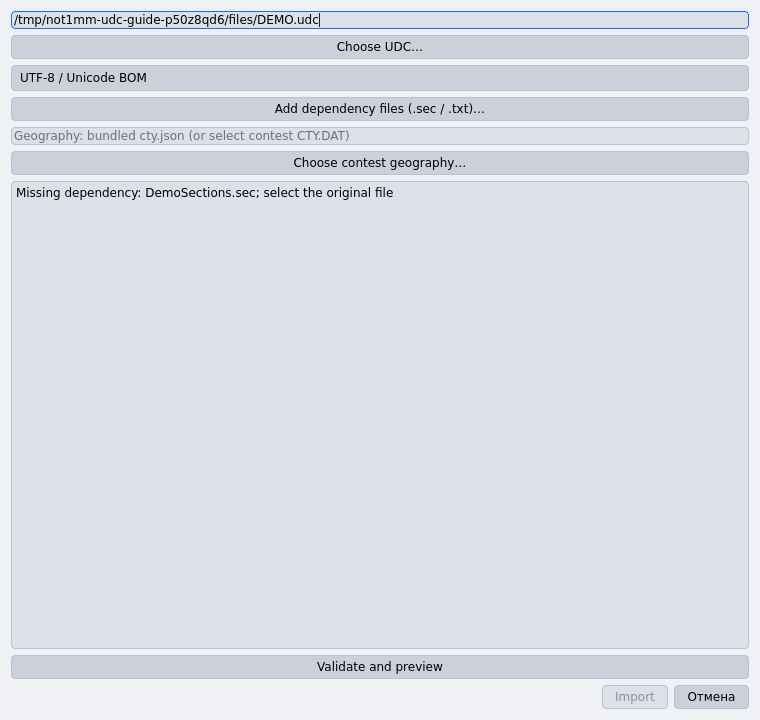
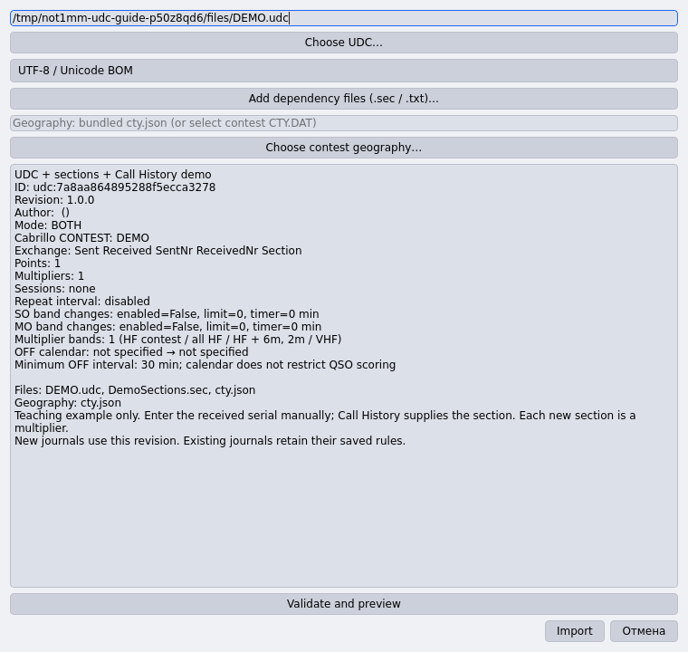
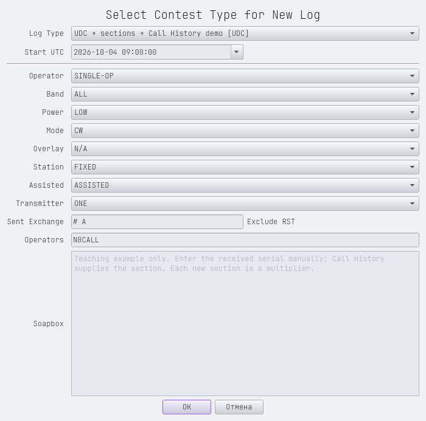
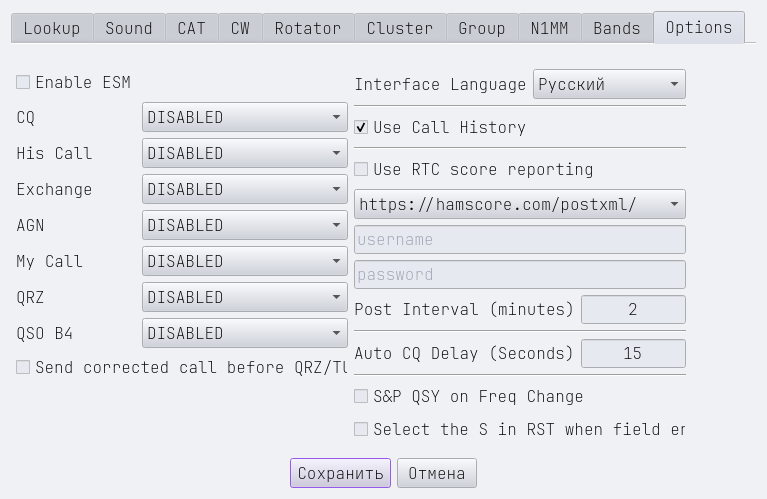
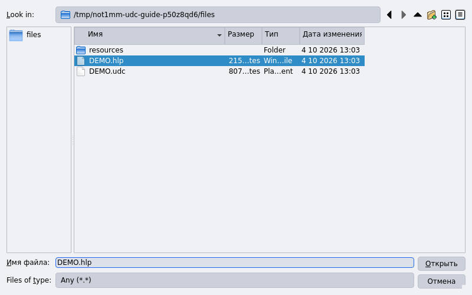
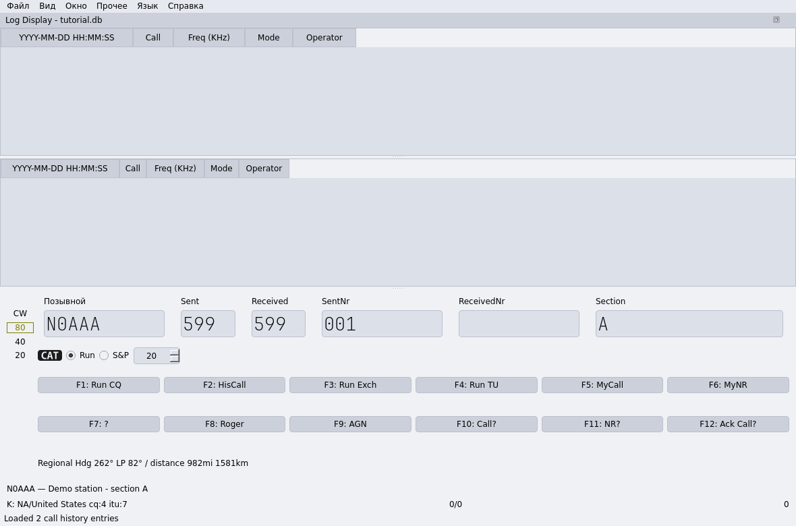

# Connecting UDC, SEC and HLP files

[Русский](udc-setup-ru.md) · [Supported rules and limitations](user-defined-contests.md)

A `.udc` defines contest rules, a `.sec` lists sections or districts, and a
Call History `.hlp` provides callsign hints. Import the UDC and its required
resources together. Load HLP separately into the current logging database.

## 1. Prepare the files

Use the project's original teaching files:

- [DEMO.udc](../examples/udc/tutorial/DEMO.udc): demonstration rules;
- [DemoSections.sec](../examples/udc/tutorial/resources/DemoSections.sec): sections A and B;
- [DEMO.hlp](../examples/udc/tutorial/DEMO.hlp): two fictional Call History records.

Download their raw contents, or use the files in a clone of this repository.
They are GPL-3.0-or-later teaching examples, not official contest rules.

The SEC is in the `resources` subdirectory to demonstrate explicit selection.
A required SEC next to the UDC is detected automatically. Its name must match
the definition's request: here it is `DemoSections.sec`, with
`Type=DemoSections` on the first line.

Back up existing operator databases before opening them with an updated
application. For this walkthrough, use a separate teaching database and enter
station settings. Screenshots use the Russian interface; some controls retain
their original English labels. English menu paths are given below.

## 2. Select the UDC

Open **File → Import User Contest…**, click **Choose UDC…** and select `DEMO.udc`.
Validation runs immediately. Until you add the SEC from the subdirectory,
**Missing dependency: DemoSections.sec** appears and **Import** remains disabled.



## 3. Add the SEC and import

Click **Add dependency files (.sec / .txt)…** and select
`resources/DemoSections.sec`. Use **Validate and preview** and check that
**Files** includes both the UDC and SEC. The example uses bundled `cty.json`
geography; no additional CTY.DAT is required.

Select the correct encoding if the original files are not Unicode. Review the
mode, exchange and rules, then click **Import**.



An unsupported active rule or invalid reference file blocks import. Keep the
requested resource names and use the resources belonging to that definition.

## 4. Create a journal

Open **File → New Contest** and select
**UDC + sections + Call History demo [UDC]**. Set the actual UTC start time,
category and CW or SSB+CW mode. For this example, use sent exchange `# A`:
`#` denotes the sent serial and `A` your section. Confirm the new journal.



The journal retains its rules, SEC, geography and engine version. Importing
an updated UDC affects new journals; existing ones retain their saved rules.

## 5. Enable Call History

Open **File → Configuration Settings → Options**, enable **Use Call History**
and save the settings.



## 6. Load HLP and check the hint

Open **File → Load Call History File** and select `DEMO.hlp`.
The status bar reports **Loaded 2 call history entries**.



Do not add HLP through the UDC dependency button. Call History uses UTF-8 CSV
with an optional BOM; the extension alone does not determine the format.
The example contains:

```text
!!Order!!,Call,Exch1,Sect,UserText
N0AAA,A,A,Demo station - section A
N0BBB,B,B,Demo station - section B
```

Type `N0AAA` to see the section A hint. Press **Tab**, **Space**, or click an
exchange field: an empty **Section** becomes `A`. **ReceivedNr** stays empty;
enter the received serial, for example `7`, yourself.



Existing entries are preserved. Changing the call to `N0BBB` clears the unedited
automatic A value; leaving the callsign again fills B. An operator-edited value
is preserved.

## Troubleshooting

| Symptom | Check |
| --- | --- |
| **Missing dependency** | Put the requested SEC next to the UDC or select it with **Add dependency files**. |
| **Type=** error | The SEC's first-line type matches its filename without `.sec`. |
| Unreadable text | Select the UDC/resource encoding; Call History requires UTF-8. |
| HLP rejected | Include `!!Order!!`, a `Call` column and comma-separated fields. |
| Loaded records but no hint | Enable **Use Call History**, use the correct database and match the call including suffixes such as `/P`. |
| Hint shown but no field filled | Leave the callsign field; the value must fit the UDC fields and rules. Received serials are never filled. |

A successful Call History import replaces that database's previous list;
an invalid file preserves it. Call History is not part of the UDC definition
export. Before a real contest, verify the rules, scoring and export with a few
teaching contacts.
