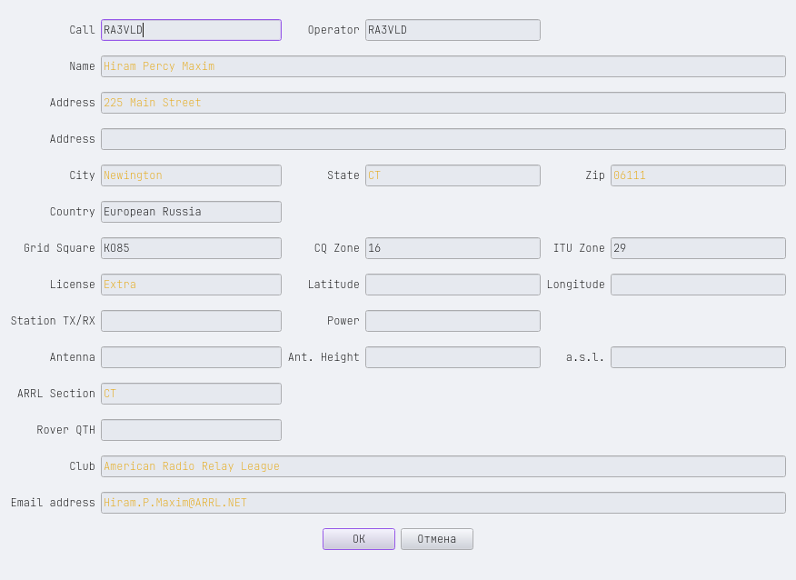
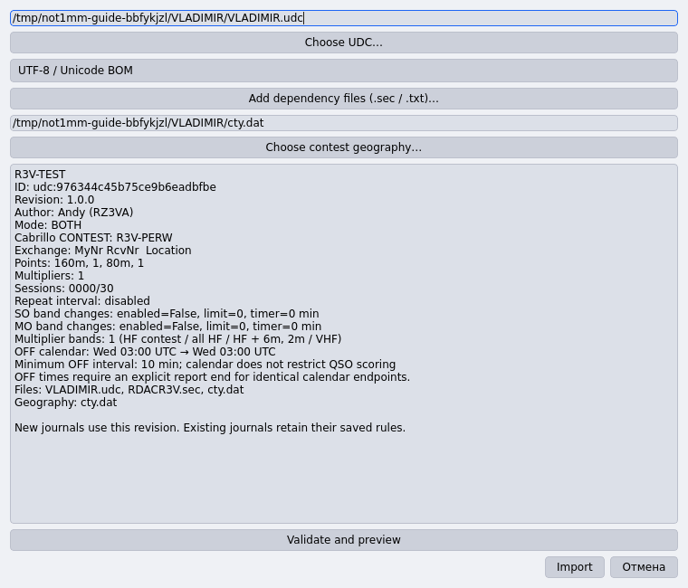
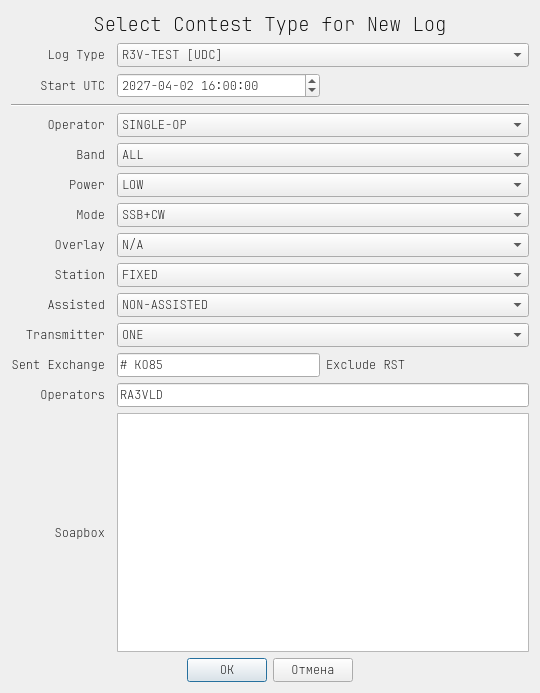
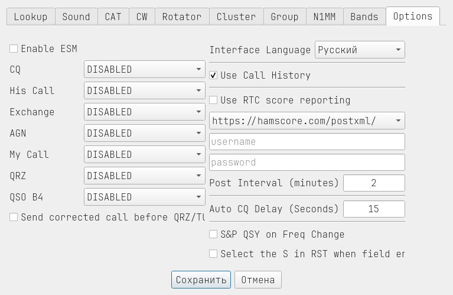
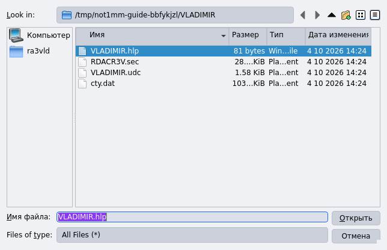
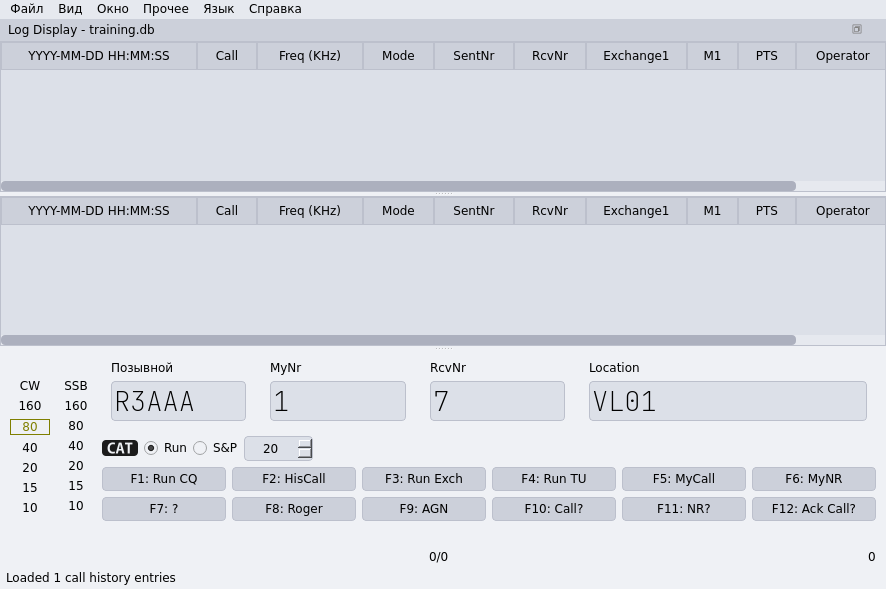
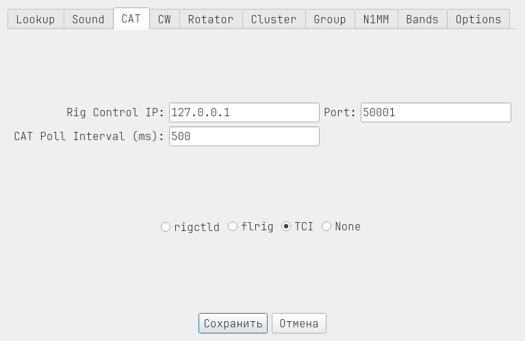
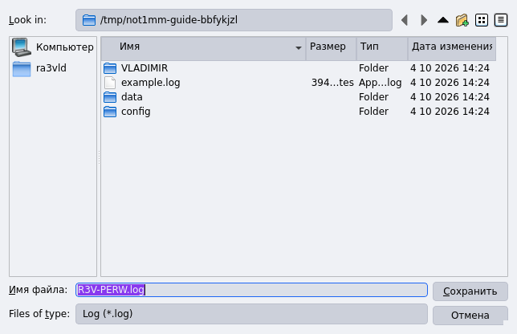

# Not1MM для Владимирского теста

Эта инструкция поможет установить Not1MM, загрузить готовые настройки
и создать журнал Владимирского теста. Понадобятся компьютер с Linux,
доступ в Интернет и ваш позывной.

Команды установки ниже подходят для **Linux Mint и Ubuntu**.
В примерах использованы позывной **RA3VLD** и локатор **KO85** —
при настройке укажите свои данные.

## 1. Скачайте программу и файлы соревнования

### Программа — с GitHub

1. Откройте в браузере [страницу скачивания Not1MM](https://github.com/ra3vld/not1mm/releases/latest).
2. Найдите список **Assets** внизу описания выпуска. Если список свёрнут,
   нажмите на слово **Assets**.
3. Нажмите на файл, название которого заканчивается на **.flatpak**.
   Дождитесь окончания скачивания. **Source code (zip)** и **Source code (tar.gz)** скачивать не нужно.
4. Откройте папку **Загрузки**. Если скачанный файл называется иначе,
   выделите его, нажмите **F2** и переименуйте в **not1mm.flatpak**.

### Настройки — с сайта Владимирского радиоклуба

1. Откройте [страницу Владимирского теста на r3v.ru](http://r3v.ru/contest).
2. Найдите комплект настроек **для Not1MM** и скачайте его.
3. Если скачался архив **.zip**, нажмите на него правой кнопкой мыши и выберите
   **Распаковать здесь** или **Извлечь сюда**. Откройте полученную папку.
4. Убедитесь, что в ней есть следующие файлы. Оставьте их вместе;
   из открытого архива программа их не загрузит.

| Файл | Для чего он нужен |
| --- | --- |
| not1mm.json | Готовые настройки программы. |
| VLADIMIR.udc | Правила и поля обмена Владимирского теста. |
| RDACR3V.sec | Справочник районов и квадратов для подсчёта множителей. |
| Файл .hlp | Подсказки по позывным: район или локатор корреспондента. |
| cty.dat | Справочник стран и позывных. |

**Запомните эту папку:** из неё вы будете выбирать файлы на следующих шагах.
Файл `.hlp` может называться, например, `VLADIMIR.hlp` — выбирайте тот,
который находится в скачанном комплекте.

<!-- pagebreak -->

## 2. Установите Not1MM

### Подготовьте Linux

1. Нажмите одновременно **Ctrl + Alt + T**. Откроется окно **Терминал**.
2. Скопируйте первую команду ниже. В терминале вставьте её сочетанием
   **Ctrl + Shift + V** и нажмите **Enter**.
3. Если программа запросит пароль, введите **пароль входа в Linux** и нажмите
   **Enter**. При вводе пароля символы и звёздочки не показываются — это нормально.
4. Если появится вопрос о продолжении, введите **Y** и нажмите **Enter**.
   Дождитесь завершения команды. Затем таким же способом выполните остальные
   команды, по одной строке.

```sh
sudo apt update
sudo apt install flatpak
flatpak remote-add --user --if-not-exists flathub https://dl.flathub.org/repo/flathub.flatpakrepo
```

Если Flatpak уже установлен, повторная команда его установки ничего не испортит.
После завершения закройте окно терминала.

### Установите скачанный файл

1. Откройте папку **Загрузки**, в которой лежит **not1mm.flatpak**.
2. Нажмите правой кнопкой мыши **на свободном месте внутри папки**, затем
   выберите **Открыть в терминале**. Окно терминала откроется в нужной папке.
3. Вставьте команду ниже и нажмите **Enter**:

```sh
flatpak install --user ./not1mm.flatpak
```

4. При запросе установки дополнительных компонентов или подтверждения
   введите **Y** и нажмите **Enter**. Дождитесь окончания загрузки и установки.
   Первый раз это может занять несколько минут.
5. Закройте терминал. Пока **не запускайте Not1MM**: сначала подключите
   готовые настройки, как описано на следующей странице.

**Если написано «файл не найден»:** вернитесь в папку Загрузки и проверьте,
что файл называется ровно `not1mm.flatpak`. Команду нужно выполнять из папки,
в которой находится этот файл.

<!-- pagebreak -->

## 3. Подключите готовые настройки программы

На этом шаге нужен файл **not1mm.json** из комплекта с r3v.ru.
Not1MM должен быть закрыт. Если вы уже запускали его, закройте окно программы.

1. Откройте **распакованную папку настроек**, в которой лежит `not1mm.json`.
2. Нажмите правой кнопкой мыши на свободном месте в этой папке и выберите
   **Открыть в терминале**.
3. Скопируйте первую команду ниже, вставьте её через **Ctrl + Shift + V**
   и нажмите **Enter**. Затем выполните вторую команду.

```sh
mkdir -p "$HOME/.var/app/io.github.mbridak.not1mm/config/not1mm"
cp ./not1mm.json "$HOME/.var/app/io.github.mbridak.not1mm/config/not1mm/not1mm.json"
```

Эти две команды создают папку настроек Not1MM и помещают туда скачанный файл.
Если всё прошло успешно, терминал просто перейдёт на новую строку,
без сообщения об ошибке.

4. Теперь в этом же терминале выполните:

```sh
flatpak run io.github.mbridak.not1mm
```

Откроется Not1MM. В дальнейшем его можно запускать через меню приложений Linux:
откройте меню, введите **Not1MM** в поиске и нажмите на найденный значок.
Если значок пока не появился, выйдите из сеанса Linux и войдите снова
или используйте команду запуска выше.

**Что уже настроено:** программа прочитала общие настройки из `not1mm.json`.
Данные вашей станции, правила соревнования и подсказки по позывным
вы подключите на следующих шагах.

**Если написано «cannot stat» или «нет такого файла»:** проверьте,
что `not1mm.json` лежит в открытой папке. Не выполняйте команды копирования
из папки с архивом — сначала распакуйте его.

<!-- pagebreak -->

## 4. Укажите данные своей станции

При первом запуске откроется окно с данными станции. Заполните его.
Если главное окно уже открыто, выберите **Файл → Настройки станции**
(**File → Station Settings**).

| Поле на экране | Что вписать |
| --- | --- |
| Call | Ваш позывной. В примере RA3VLD. |
| Operator | Позывной оператора. Для своей станции обычно тот же позывной. |
| Name | Ваши имя и фамилия. |
| Email address | Ваша электронная почта для связи с судейской коллегией. |
| Address / City | Ваш адрес и населённый пункт. |
| Grid Square | Ваш QTH-локатор. В примере KO85. |
| CQ Zone / ITU Zone | Ваши зоны. Для примера RA3VLD — 16 и 29. |



Нажмите **OK**. Если программа затем предлагает выбрать соревнование,
пока выберите **General Logging** и нажмите **OK**. Связи в этот журнал
не вводите. Сначала мы загрузим Владимирский тест, затем создадим нужный журнал.

Если меню на английском, выберите **Language → Русский**.
В русской версии меню этот пункт называется **Язык → Русский**.

<!-- pagebreak -->

## 5. Загрузите правила Владимирского теста

1. В главном окне выберите **Файл → Импорт соревнования UDC…**
   (**File → Import User Contest…**).
2. Нажмите кнопку **Choose UDC…** — «Выбрать UDC».
3. В окне выбора файла откройте распакованную папку настроек с r3v.ru,
   выделите **VLADIMIR.udc** и нажмите **Открыть**.
4. Нажмите **Add dependency files (.sec / .txt)…** — «Добавить справочники».
   В той же папке выберите **RDACR3V.sec** и нажмите **Открыть**.
5. Нажмите **Choose contest geography…** — «Выбрать справочник стран».
   Выберите **cty.dat** из той же папки и нажмите **Открыть**.
6. Нажмите **Validate and preview** — «Проверить и показать».



В большом поле должна появиться строка **R3V-TEST**, а в строке **Files** —
`VLADIMIR.udc`, `RDACR3V.sec` и `cty.dat`. Кнопка **Import** внизу должна
стать доступной. Нажмите **Import** — «Импортировать».

Если появилось **Missing dependency: RDACR3V.sec**, ещё раз выполните шаг 4.
Если вместо описания появилась другая ошибка, не продолжайте настройку:
проверьте, что выбраны файлы именно из комплекта для Not1MM с r3v.ru.

**Результат:** Владимирский тест появился в списке соревнований программы.
Файл `.hlp` здесь не выбирайте — он загружается отдельно на шаге 7.

<!-- pagebreak -->

## 6. Создайте журнал Владимирского теста

1. Выберите **Файл → Новый контест** (**File → New Contest**).
2. В верхнем списке **Log Type** выберите **R3V-TEST [UDC]**.
3. Заполните поля по таблице. Дату и время начала возьмите из положения
   соревнования на [r3v.ru/contest](http://r3v.ru/contest).
   Остальные поля оставьте как на снимке ниже.

| Поле на экране | Что выбрать или вписать |
| --- | --- |
| Start UTC | Дата теста и время начала в UTC. В примере 02.04.2027, 16:00:00. |
| Operator | SINGLE-OP — один оператор; MULTI-OP — коллективная станция. |
| Band | ALL. Это категория журнала для двух диапазонов, 160 и 80 м. |
| Mode | SSB+CW для смешанного зачёта; CW только для телеграфа; SSB только для телефона. |
| Power | LOW или HIGH по вашей фактической мощности. |
| Sent Exchange | `# VL01`, если вы работаете из района VL01; вне области — `# KO85` со своим локатором. |
| Operators | Ваш позывной или позывные операторов коллективной станции. |



Знак **#** означает порядковый номер. После него — пробел и
**свой район VLxx** для Владимирской области либо **свой локатор** вне области.

Нажмите **OK**. Теперь открыт журнал Владимирского теста.

<!-- pagebreak -->

## 7. Включите подсказки по позывным

1. Откройте **Файл → Настройки** (**File → Configuration Settings**).
2. Нажмите вкладку **Options** в верхней части окна.
3. Поставьте галочку **Use Call History** — «Использовать подсказки по позывным».
4. Нажмите **Сохранить** (**Save**).



Эта настройка разрешает показывать район или локатор известного корреспондента.
Теперь нужно загрузить сам список позывных, как описано на следующей странице.

<!-- pagebreak -->

## Загрузите файл подсказок

1. Выберите **Файл → Загрузить файл истории вызовов**
   (**File → Load Call History File**).
2. Откройте распакованную папку настроек с r3v.ru.
3. Выделите файл с окончанием **.hlp** и нажмите **Открыть**.
   На снимке он называется `VLADIMIR.hlp`.



В нижней строке окна появится сообщение **Loaded … call history entries** —
«Загружено … записей подсказок». Вместо многоточия будет число позывных.

При вводе известного позывного программа покажет подсказку.
После **Tab** она может заполнить пустое поле района или локатора.
**Принятый порядковый номер программа не подставляет:** его нужно услышать
в эфире и ввести самостоятельно. Район и локатор тоже сверяйте с тем,
что передал корреспондент.

Если подсказок нет, проверьте галочку **Use Call History** из предыдущего шага
и повторно загрузите `.hlp`.

<!-- pagebreak -->

## 8. Проверьте готовый журнал

В нижней части окна должны быть поля **Позывной**, **MyNr**, **RcvNr**,
**Location**, как на снимке.



| Поле | Что означает |
| --- | --- |
| Позывной / Callsign | Позывной корреспондента. |
| MyNr | Ваш порядковый номер связи. Первая связь — 1. |
| RcvNr | Принятый порядковый номер. Например, если услышали 007, введите 7. |
| Location | Принятый район VLxx или полный квадрат локатора, например KO85. |

**Перед началом работы проверьте:**

- Выбран журнал **R3V-TEST [UDC]** и ваша зачётная группа.
- Указаны ваш позывной и правильный собственный обмен: `# VLxx` или `# локатор`.
- Время начала соответствует положению соревнования и указано в **UTC**.
- После загрузки `.hlp` появилось число записей подсказок.

В эфире передавайте номер и район/локатор, например **001 VL01**.
RST в обмен Владимирского теста не входит. Свой порядковый номер не сбрасывайте
при смене диапазона, моды или подтура.

Для сохранения реальной связи заполните поля и нажмите **Enter** в последнем
поле. Запись должна появиться в журнале, а свой номер — увеличиться.
Не сохраняйте вымышленные связи в журнал соревнования.

<!-- pagebreak -->

## Частота, вид работы и связь с трансивером

Если готовый комплект настроек рассчитан на ваш трансивер, включите его
и проверьте, что Not1MM показывает правильные частоту и вид работы.
Если они не меняются вместе с трансивером, откройте
**Файл → Настройки → CAT** (**File → Configuration Settings → CAT**).



Здесь выбирается способ соединения с трансивером. **TCI**, **flrig** и
**rigctld** — разные способы; выберите тот, который используется у вас.
Адрес и порт должны совпадать с настройками программы управления трансивером.
На снимке показан пример TCI на том же компьютере: адрес `127.0.0.1`, порт `50001`.
Эти значения подходят только для такого подключения.

Если вы пока вводите данные без подключения к трансиверу, выберите **None**
и нажмите **Сохранить**. Сначала нажмите кнопку диапазона **80** или **160**
в столбце **CW** или **SSB**. Затем введите фактическую частоту в поле позывного
в килогерцах, например `3510`, и нажмите **пробел**. При ручном вводе перед каждой
связью проверяйте, что частота и мода совпадают с трансивером.

Управление частотой не настраивает автоматически звук, ключ и передачу.
Для начала обмен можно передавать обычным ключом или голосом,
пользуясь своим номером на экране.

<!-- pagebreak -->

## После соревнования: сохраните отчёт

1. Выберите **Файл → Создать Cabrillo UTF-8**
   (**File → Generate Cabrillo UTF-8**).
2. В окне сохранения выберите, например, папку **Документы**.
3. В поле имени файла впишите **свой позывной.log**, например `RA3VLD.log`.
4. Нажмите **Сохранить**.



Откройте сохранённый файл текстовым редактором: нажмите на него правой кнопкой
мыши и выберите **Открыть с помощью → Текстовый редактор**.
Проверьте свой позывной, имя, электронную почту, группу, дату и время связей.
В строках QSO должны быть переданный и принятый номера, районы или локаторы.
Не удаляйте повторные связи из отчёта.

Отправьте файл способом, указанным в положении на
[r3v.ru/contest](http://r3v.ru/contest). Нажатие **Сохранить** только создаёт файл
на компьютере и не отправляет его судейской коллегии.

## Если что-то не получилось

| Что вы видите | Что сделать |
| --- | --- |
| «flatpak: команда не найдена» | Повторите установку Flatpak на шаге 2. |
| «Файл не найден» при установке | Откройте терминал из папки с not1mm.flatpak и проверьте имя файла. |
| Нет пункта «Импорт соревнования UDC…» | Проверьте, что установлен Flatpak по ссылке из шага 1. |
| Missing dependency: RDACR3V.sec | Выберите RDACR3V.sec кнопкой Add dependency files. |
| Нет R3V-TEST [UDC] в списке | Вернитесь к шагу 5 и нажмите Import после проверки файлов. |
| Нет подсказок по позывным | Включите Use Call History и загрузите файл .hlp. |
